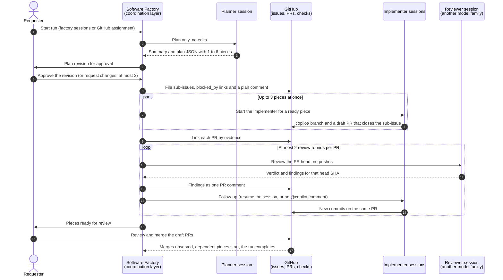

# GitHub runs: the factory coordinates, GitHub-hosted Copilot executes

For GitHub repositories, Software Factory works on an issue with a team of Copilot cloud agents, in two layers:

- **The coordination layer is the factory.** It runs a planner session and holds the requester's approval of the plan. Then it files the approved pieces as sub-issues, schedules implementers, runs review rounds with a model from another family, and follows up. It keeps the evidence, receipts and measured cost.
- **The execution layer is GitHub.** Every agent runs on GitHub-hosted compute under the requester's Copilot license and pushes only to its own branch. Every write lands on GitHub, made by the requester or by Copilot.

We chose this so that the factory never has to own a sandbox, a worker fleet or a second agent runtime for GitHub work, and so that the team sees the work where it already looks.

Implementers run in one of two modes, chosen per run:

- **Factory sessions:** the factory creates, streams and resumes SDK cloud sessions.
- **GitHub assignment:** the factory assigns each sub-issue to Copilot and follows up with `@copilot` comments.

The planner and the reviewer always run as SDK cloud sessions. GitHub's agent tasks API reports state, artifacts and usage, but not what an agent said, and a plan or a verdict has to come back as data.

## Considered options

- **Run agents on the factory host.** This gives full control and one runtime for every provider, but the factory would own sandboxing, worker lifecycle and recovery. Rejected for GitHub. It remains the likely path for Azure DevOps, which will be decided separately.
- **One lead cloud session that splits the work internally.** This produces one large PR, with no sub-issues and no review by another model family, and running sub-agents in parallel inside a cloud session is undocumented. Rejected.
- **Only one implementer mode.** Factory sessions give live progress and usage per session. GitHub assignment gives native linking and visibility in GitHub's own interface. The requester wanted the choice.

## Consequences

- GitHub assignment needs broader GitHub App permissions than factory sessions: write access to Actions, Contents, Issues and Pull requests, versus Issues and Pull requests only. An installation without the broader permissions offers factory sessions only.
- Runs replace single-session tasks for GitHub. A run only advances while the factory is running, although its sessions keep going on GitHub.
- By default, GitHub holds Actions on Copilot's pushes until someone approves them, so a piece can wait for the requester before its checks run.
- Azure DevOps has no hosted agent. Its runner on the factory host is a separate decision.

## Actor flow

See the [design](../superpowers/specs/2026-11-28-github-team-runs-design.md) and the [diagrams](../architecture/github-team-runs/README.md).
