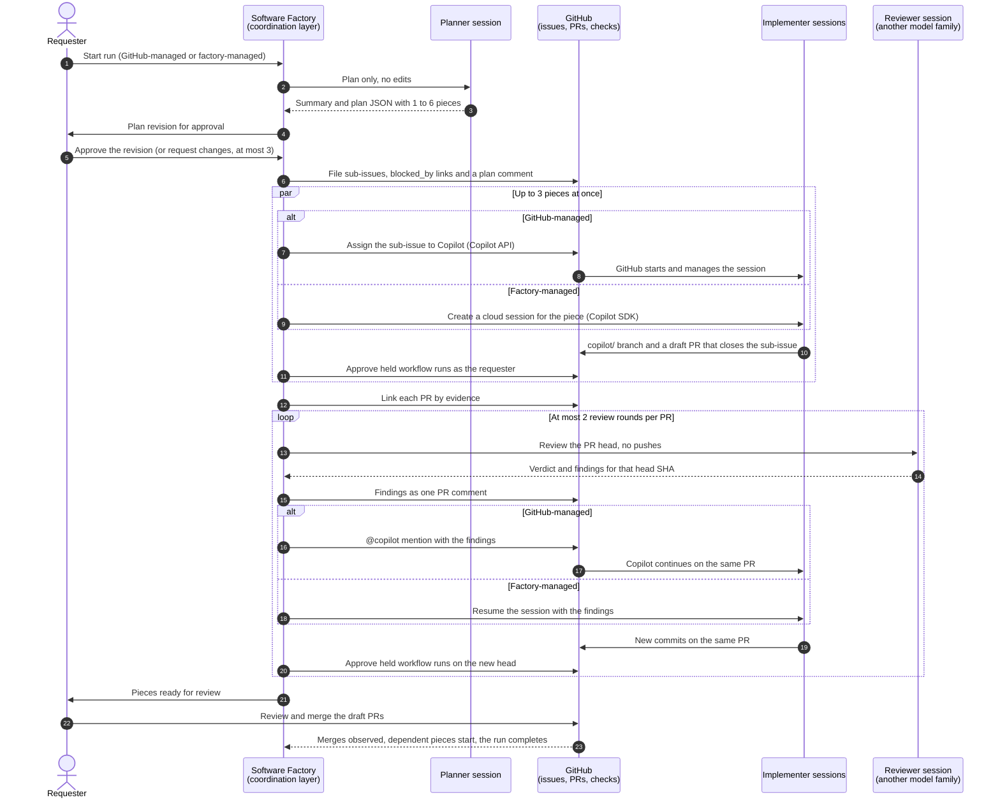

# GitHub runs: GitHub-managed or factory-managed Copilot work

For repositories on GitHub, Software Factory never runs repository code itself. Every agent runs on GitHub-hosted Copilot under the requester's Copilot license, and pushes only to its own branch. A run's implementation work gets done in one of two ways, chosen per run. This choice is the run's **work mode**:

- **GitHub-managed.** The factory works through GitHub's Copilot API. It assigns each piece's sub-issue to Copilot and steers the work with `@copilot` mentions on the pull request. GitHub creates and manages the sessions, and the factory follows them through the agent tasks API.
- **Factory-managed.** The factory creates and manages Copilot cloud sessions itself, through the Copilot SDK. It streams their progress, resumes them with follow-ups, and holds their IDs.

Both work modes share the same two layers:

- **The factory is the coordination layer.** It runs a planner session and holds the requester's approval of the plan. Then it files the approved pieces as sub-issues, schedules implementers, runs review rounds with a model from another family, follows up, and approves the workflow runs that GitHub holds on Copilot's pushes, as the requester. It keeps the evidence, receipts and measured cost.
- **GitHub is the execution layer.** Every session, branch, pull request and check lives there. Every write is made by the requester or by Copilot.

Planning and the review by another model family always run as factory-managed cloud sessions, in both work modes. GitHub's agent tasks API reports state, artifacts and usage, but not what an agent said, and a plan or a verdict has to come back as data.

We chose this so that the factory never owns a sandbox, a worker fleet or a second agent runtime for GitHub work, and so that the team sees the work where it already looks. We offer both work modes because they trade off different things. GitHub-managed work is native to GitHub: it is linked and shown by GitHub's own interface. Factory-managed work gives live progress, direct follow-ups and usage per session.

## Considered options

- **Run agents on the factory host.** This gives full control and one runtime for every provider, but the factory would own sandboxing, worker lifecycle and recovery. Rejected for GitHub. It remains the likely path for Azure DevOps, which will be decided separately.
- **One lead cloud session that splits the work internally.** This produces one large PR, with no sub-issues and no review by another model family, and running sub-agents in parallel inside a cloud session is undocumented. Rejected.
- **Only one work mode.** The requester wanted both.
- **Leave held workflow runs to the requester or to repository policy.** Waiting for the requester to approve every run would stall unattended runs, and turning off the repository policy removes the check altogether. The requester chose to have the factory approve held runs as them, except on pull requests that change workflow files.

## Consequences

- Both work modes need Actions: write, Issues: write and Pull requests: write, to approve held workflow runs and to file and comment. GitHub-managed work also needs Contents: write to assign Copilot. An installation without that permission offers factory-managed work only.
- An approved run executes Copilot's unreviewed code with the workflows' secrets and permissions, as GitHub warns. A pull request that changes workflow files waits for the requester to approve its runs on GitHub.
- Runs replace single-session tasks for GitHub. A run only advances while the factory is running, although its sessions keep going on GitHub.
- Azure DevOps has no hosted agent. Its runner on the factory host is a separate decision.

## Actor flow

See the [design](../superpowers/specs/2026-11-28-github-team-runs-design.md) and the [diagrams](../architecture/github-team-runs/README.md).
