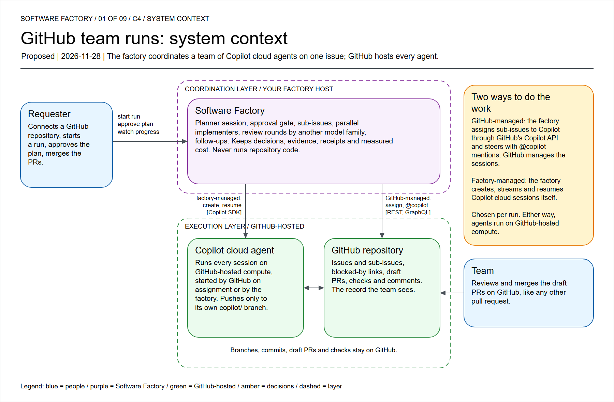
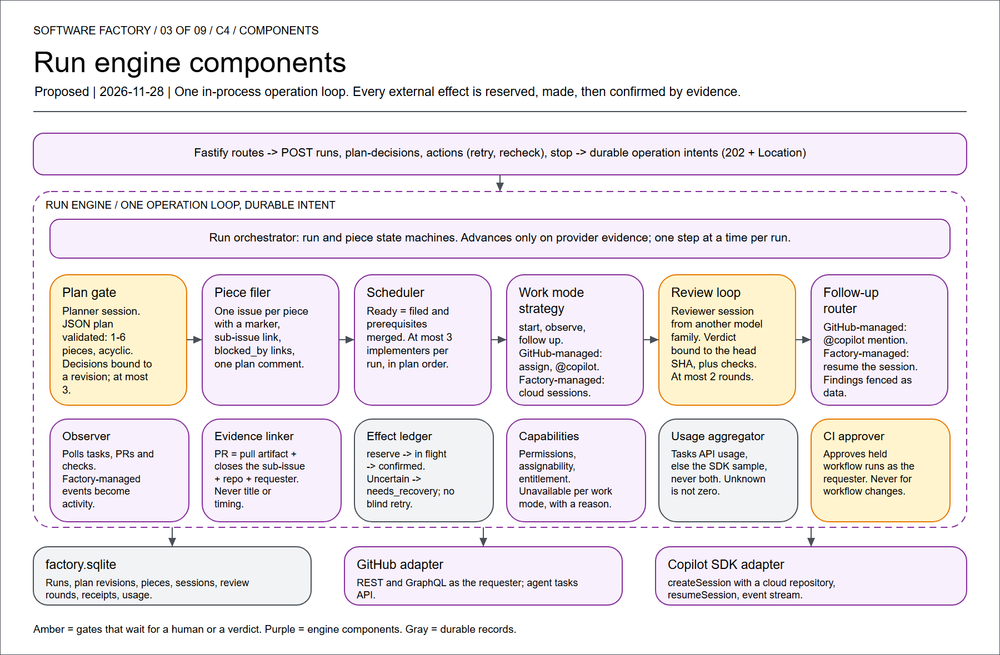
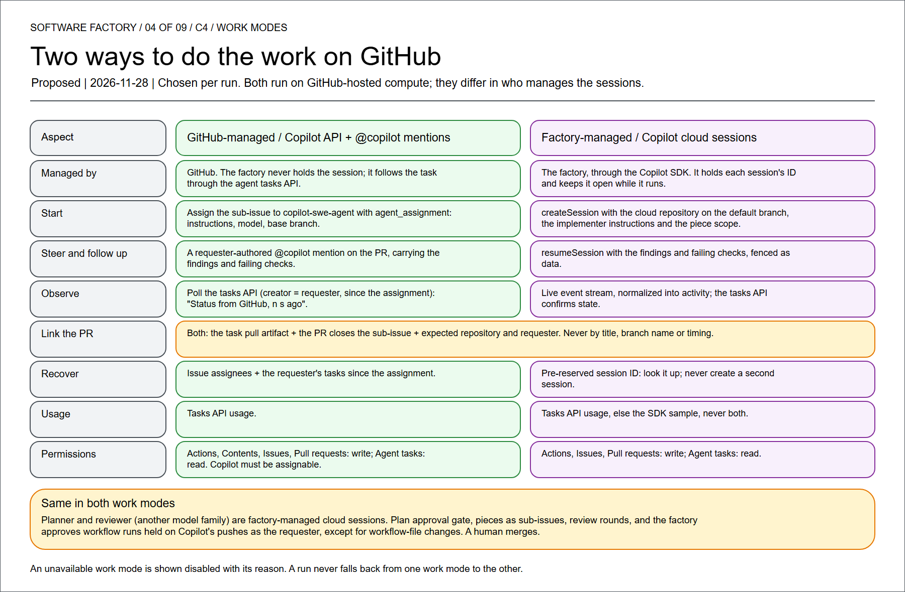
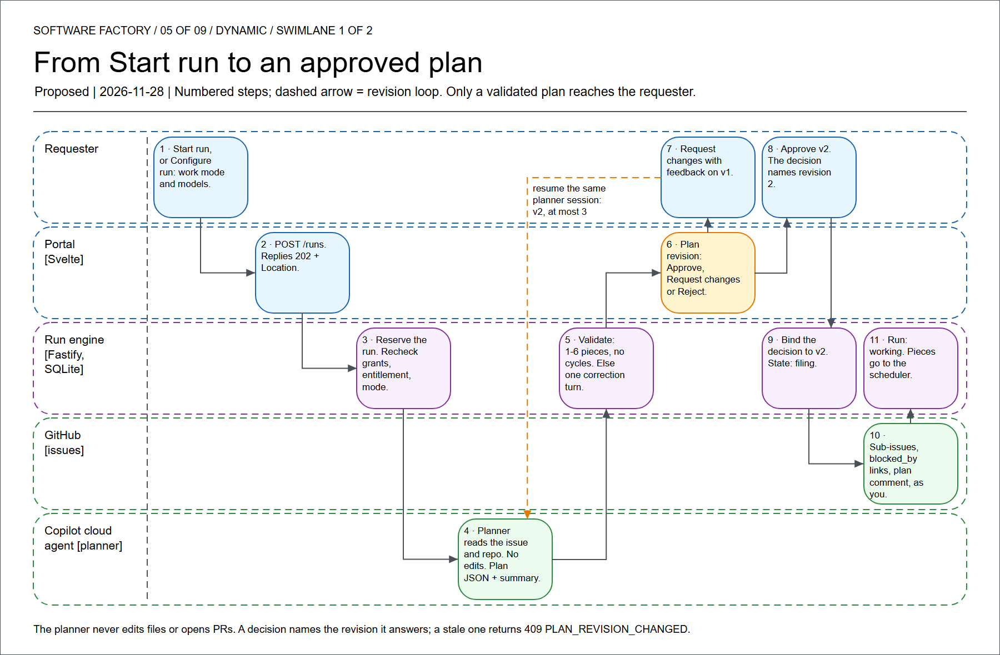
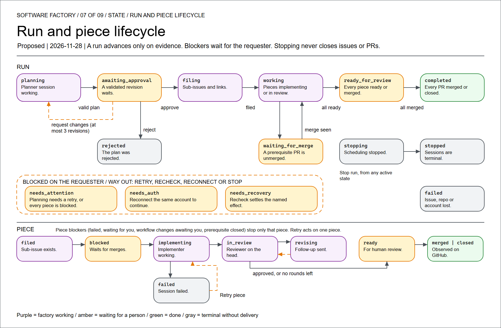
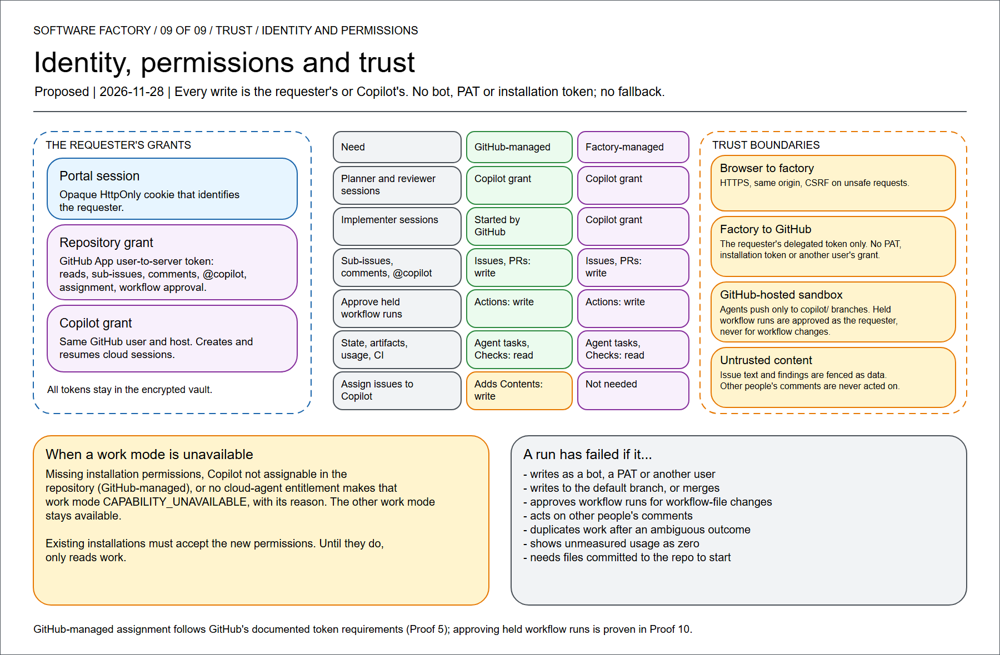

# GitHub team runs: diagrams

These diagrams show [GitHub team runs](../../superpowers/specs/2026-11-28-github-team-runs-design.md), which work in two layers:

- **Coordination layer:** Software Factory coordinates a team of Copilot cloud agents on one issue.
- **Execution layer:** GitHub-hosted Copilot does the work.

On GitHub, that work gets done in one of two ways, chosen per run as its **work mode**:

- **GitHub-managed:** the factory works through GitHub's Copilot API. It assigns sub-issues to Copilot and steers with `@copilot` mentions, and GitHub manages the sessions.
- **Factory-managed:** the factory creates, streams and resumes Copilot cloud sessions itself.

The decision is recorded in [ADR 0001](../../adr/0001-github-runs-github-managed-or-factory-managed.md).

The editable source is [`github-team-runs-c4.excalidraw`](github-team-runs-c4.excalidraw), and the Excalidraw extension for VS Code opens it directly. Each PNG renders one frame of that file, so update the PNGs whenever you change the source.

## 1. System context

The requester and the team, Software Factory in the coordination layer, the Copilot cloud agent and GitHub repository in the execution layer, and the two work modes.

## 2. Containers

The portal, API, run engine, identity and stores that coordinate, and the GitHub APIs, Mission Control sessions and repository that execute.

## 3. Run engine components

The plan gate, piece filer, scheduler, work mode strategy, review loop and follow-up router. Below them sit the components that support them: the observer, evidence linker, effect ledger, capability checks, usage aggregator and CI approver.

## 4. Two ways to do the work

GitHub-managed work (the Copilot API and `@copilot` mentions) and factory-managed work (Copilot cloud sessions the factory manages), side by side. For each, the frame shows who manages the sessions, how work starts, how it's steered and observed, how a PR is linked, how a lost outcome is recovered, how usage is reported, and what permissions each needs.

## 5. Swimlane: plan and approval

From **Start run** to an approved plan, including the revision loop.

## 6. Swimlane: build, review, merge

One piece, from implementer start through CI approval and review rounds by another model family to a human merge.

## 7. Run and piece lifecycle

The run and piece states, the blockers that wait for the requester, and the ways out of each.

## 8. Effects, evidence and recovery

For every external effect, including approving a held workflow run: what is reserved before acting, what confirms it, and how an uncertain outcome is settled.

## 9. Identity, permissions and trust

The requester's grants, the permissions each work mode needs, the trust boundaries, and what a run must never do.

