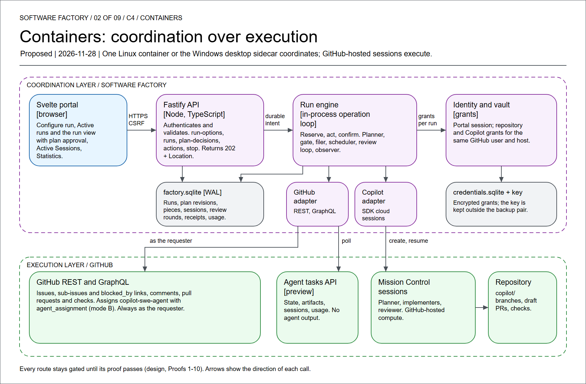
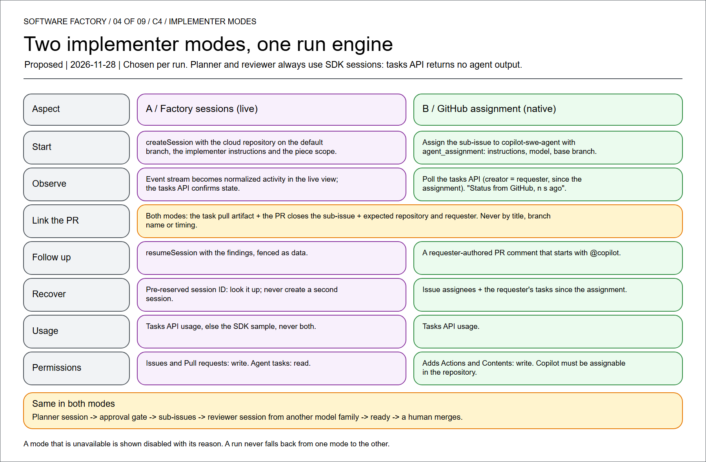
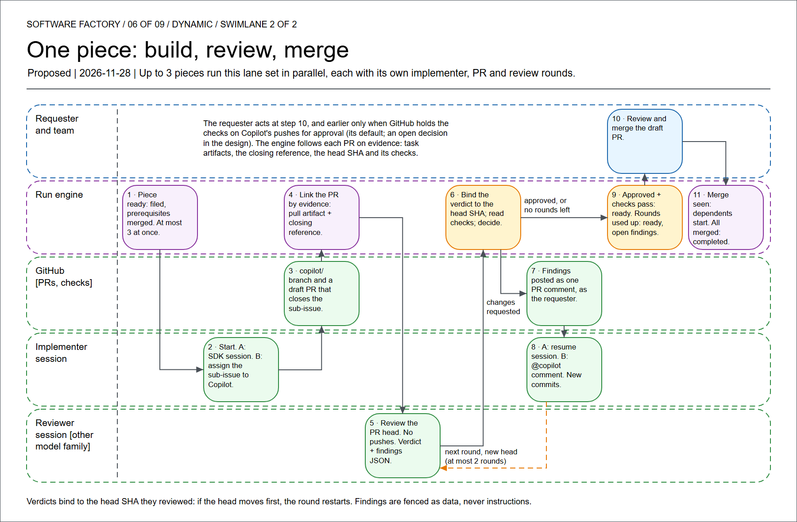
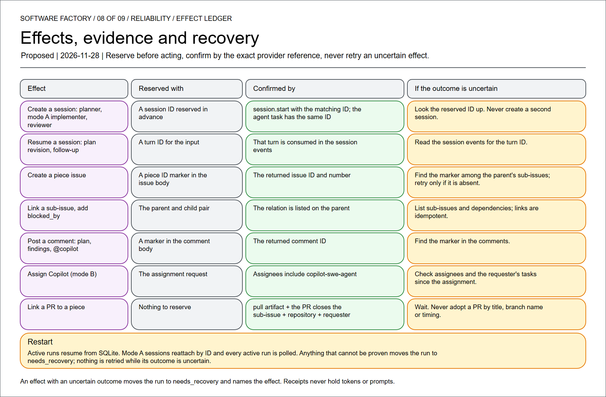

# GitHub team runs: diagrams

These diagrams show [GitHub team runs](../../superpowers/specs/2026-11-28-github-team-runs-design.md), which work in two layers:

- **Coordination layer:** Software Factory coordinates a team of Copilot cloud agents on one issue.
- **Execution layer:** GitHub-hosted Copilot does the work.

The decision is recorded in [ADR 0001](../../adr/0001-github-runs-coordinate-hosted-copilot.md).

The editable source is [`github-team-runs-c4.excalidraw`](github-team-runs-c4.excalidraw), and the Excalidraw extension for VS Code opens it directly. Each PNG renders one frame of that file, so update the PNGs whenever you change the source.

## 1. System context

The requester and the team, Software Factory in the coordination layer, and the Copilot cloud agent and GitHub repository in the execution layer.

## 2. Containers

The portal, API, run engine, identity and stores that coordinate, and the GitHub APIs, Mission Control sessions and repository that execute.

## 3. Run engine components

The plan gate, piece filer, scheduler, implementer strategy, review loop and follow-up router. Below them sit the observer, evidence linker, effect ledger, capability checker and usage aggregator that support them.

## 4. Two implementer modes

Factory sessions and GitHub assignment compared side by side: how each starts, observes, links, follows up, recovers and reports usage, and what permissions it needs.

## 5. Swimlane: plan and approval

From **Start run** to an approved plan, including the revision loop.

## 6. Swimlane: build, review, merge

One piece, from implementer start through review rounds by another model family to a human merge.

## 7. Run and piece lifecycle

The run and piece states, the blockers that wait for the requester, and the ways out of each.

## 8. Effects, evidence and recovery

For every external effect: what is reserved before acting, what confirms it, and how an uncertain outcome is settled.

## 9. Identity, permissions and trust

The requester's grants, the permissions each mode needs, the trust boundaries, and what a run must never do.

